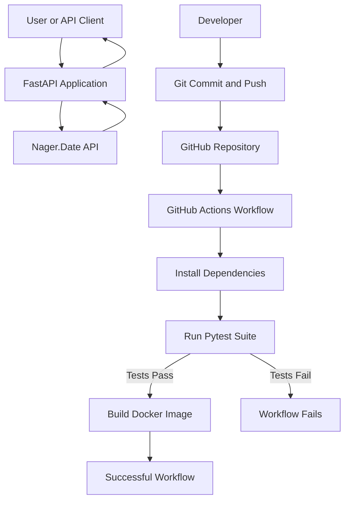
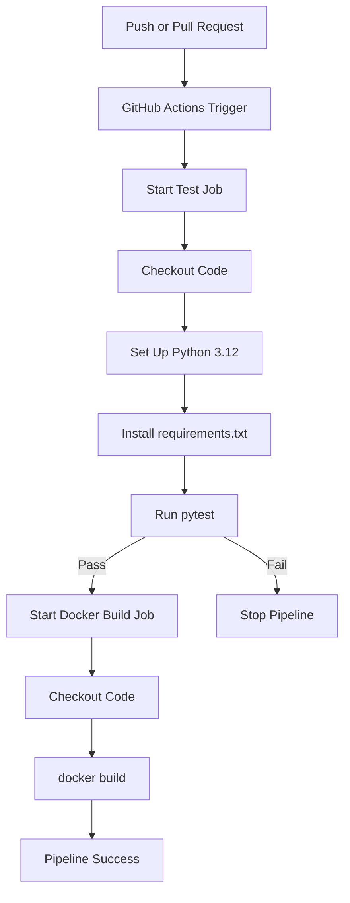

# 🚀 Public Holiday Finder — CI/CD with GitHub Actions


A Python-based Public Holiday Finder API demonstrating **Continuous Integration (CI), automated testing, Docker image building, and GitHub Actions workflows**.

The project uses the [Nager.Date API](https://date.nager.at/Api) to retrieve public holiday information by year and country code. GitHub Actions automatically runs the test suite and builds a Docker image when code is pushed to the repository.

---

## 📌 Table of Contents

- [Overview](#-overview)
- [Problem Statement](#-problem-statement)
- [Objectives](#-objectives)
- [System Architecture](#-system-architecture)
- [CI/CD Workflow](#-cicd-workflow)
- [Technology Stack](#-technology-stack)
- [Project Structure](#-project-structure)
- [Getting Started](#-getting-started)
- [API Endpoints](#-api-endpoints)
- [Automated Testing](#-automated-testing)
- [Docker](#-docker)
- [GitHub Actions](#-github-actions)
- [GitHub Secrets and Security](#-github-secrets-and-security)
- [Future Enhancements](#-future-enhancements)

---

## 🎯 Overview

This project demonstrates how to automate software testing and container image creation using GitHub Actions.

Instead of manually testing the application and building a Docker image after every code change, the project uses an automated workflow that:

1. Detects a push or pull request on GitHub.
2. Checks out the repository code.
3. Sets up the Python environment.
4. Installs project dependencies.
5. Executes automated tests using `pytest`.
6. Builds a Docker image if the test job succeeds.

The workflow provides a repeatable validation process and helps identify errors before changes are considered ready for release.

## ❗ Problem Statement

Manual testing and packaging can be inconsistent and time-consuming. Developers may forget to run tests, overlook regressions, or discover problems only after an application has been packaged.

The objective is to create an automated pipeline that validates application changes and builds a reproducible Docker image whenever code is pushed to GitHub.

## 🎯 Objectives

- Develop a REST API using Python and FastAPI.
- Integrate an external public holiday API.
- Create automated tests using `pytest`.
- Containerize the application using Docker.
- Configure GitHub Actions to run tests and build a Docker image.
- Understand workflows, jobs, steps, runners, and secure secret management.
- Demonstrate a successful automated pipeline through GitHub Actions.

---

## 🏗️ System Architecture

The application and its CI pipeline work together as follows:



**Architecture explanation:**

- **FastAPI:** exposes HTTP endpoints for retrieving public holiday data.
- **Nager.Date API:** provides external public holiday information.
- **GitHub:** stores the source code and workflow configuration.
- **GitHub Actions:** executes the automated pipeline on GitHub-hosted runners.
- **Pytest:** validates the application's expected behavior.
- **Docker:** packages the application into an image.

---

## ⚙️ CI/CD Workflow

The pipeline is defined in `.github/workflows/ci.yml`.



### Workflow components

| Component | Purpose |
|---|---|
| Workflow | Defines the complete automated pipeline. |
| Job | Groups related tasks, such as testing or Docker building. |
| Step | Executes an individual command or reusable action. |
| Runner | The machine that executes the job. This project uses `ubuntu-latest`. |
| Trigger | Starts the workflow on a push or pull request. |

### Job dependency

The Docker job includes:

```yaml
needs: test
```

This ensures that the Docker image build job waits for the test job to succeed. If the test job fails, the Docker build job is skipped.

### CI versus CD

- **Continuous Integration (CI):** automatically tests code changes.
- **Continuous Delivery:** prepares validated software so it can be released.
- **Continuous Deployment:** automatically releases qualifying changes to production.

This project implements automated testing and Docker image building. It does **not** currently publish the image to a registry or deploy the application to a production server.

---

## 🛠️ Technology Stack

| Technology | Purpose |
|---|---|
| Python 3.12 | Application programming language |
| FastAPI | REST API framework |
| Nager.Date API | External public holiday data |
| Pytest | Automated testing |
| HTTPX | HTTP requests and API testing support |
| Docker | Application containerization |
| Git and GitHub | Version control and repository hosting |
| GitHub Actions | Automated CI workflow |

---

## 📁 Project Structure

```text
ci-cd-github-actions/
│
├── .github/
│   └── workflows/
│       └── ci.yml           # CI workflow configuration
│
├── main.py                  # FastAPI application
├── test_main.py             # Automated test suite
├── requirements.txt         # Python dependencies
├── Dockerfile               # Docker image instructions
├── .gitignore               # Files excluded from Git
└── README.md                # Project documentation
```

---

## 🚀 Getting Started

### Prerequisites

Install the following tools:

- Python 3.12 or a compatible Python environment
- Git
- Docker Desktop
- A GitHub account

### 1. Clone the repository

```bash
git clone https://github.com/Tarun250506/ci-cd-github-actions.git
cd ci-cd-github-actions
```

### 2. Create a virtual environment

```bash
python3 -m venv .venv
```

Activate it on macOS or Linux:

```bash
source .venv/bin/activate
```

### 3. Install dependencies

```bash
python -m pip install --upgrade pip
pip install -r requirements.txt
```

### 4. Run the tests

```bash
python -m pytest -v
```

The current test suite contains five tests covering the home endpoint, successful holiday retrieval, invalid years, invalid country codes, and external API failure handling.

### 5. Start the API locally

```bash
uvicorn main:app --reload
```

Open the interactive API documentation:

[http://127.0.0.1:8000/docs](http://127.0.0.1:8000/docs)

---

## 🌐 API Endpoints

The application exposes the following endpoints:

| Method | Endpoint | Description |
|---|---|---|
| GET | `/` | Home endpoint |
| GET | `/holidays/{year}/{country_code}` | Retrieves holidays for the requested year and country |

### Example request

```bash
curl http://127.0.0.1:8000/holidays/2026/IN
```

Here:

- `2026` is the requested year.
- `IN` is the ISO country code for India.

The endpoint retrieves data from Nager.Date and returns the application's response. Invalid inputs and external API failures are handled by the application.

**Note:** The external service must be reachable and return suitable data for a successful live request. The automated tests also verify error handling without relying on the external service being available.

API documentation is available through FastAPI's Swagger UI at `/docs` while the application is running.

---

## 🧪 Automated Testing

The project uses `pytest` to verify application behavior.

Run the tests locally:

```bash
python -m pytest -v
```

### Test coverage

| Test | Purpose |
|---|---|
| `test_home` | Checks the home endpoint. |
| `test_get_holidays_success` | Checks successful holiday retrieval. |
| `test_invalid_year` | Checks invalid year handling. |
| `test_invalid_country_code` | Checks invalid country code handling. |
| `test_external_api_failure` | Checks behavior when the external API fails. |

The test suite passed locally, and the GitHub Actions test job completed successfully.

---

## 🐳 Docker

Docker packages the application and its dependencies into an image.

### Build the image

From the project root:

```bash
docker build -t holiday-finder:latest .
```

### Verify the image

```bash
docker images
```

The image should appear as:

```text
REPOSITORY       TAG
holiday-finder   latest
```

### Run the container

```bash
docker run --rm -p 8000:8000 holiday-finder:latest
```

If the container starts the FastAPI server on `0.0.0.0:8000`, access the API at:

[http://localhost:8000/docs](http://localhost:8000/docs)

The port mapping makes port 8000 inside the container accessible through port 8000 on the host machine.

---

## 🤖 GitHub Actions

The workflow is stored at:

```text
.github/workflows/ci.yml
```

It is triggered by pushes and pull requests.

### Pipeline behavior

1. Checks out the repository.
2. Sets up Python 3.12.
3. Installs dependencies from `requirements.txt`.
4. Runs `pytest`.
5. Builds the Docker image if tests pass.

### Verification

The initial workflow run completed successfully, with both jobs passing:

- **Run automated tests**
- **Build Docker image**

The Docker image is built on a GitHub-hosted runner during CI. This is separate from the local image built on a developer's machine.

The current workflow does not push the image to Docker Hub or deploy the application.

---

## 🔐 GitHub Secrets and Security

Secrets such as API keys, passwords, and access tokens should never be hardcoded into source code.

Hardcoded credentials can be exposed through public repositories, logs, or shared code.

GitHub Actions supports repository secrets configured under:

**Repository → Settings → Secrets and variables → Actions**

A workflow can expose a secret to a step through an environment variable when required.

This application does not currently require an API key for Nager.Date, so no secret is needed for its existing API integration.

Additional security practices include:

- Excluding `.env` files from Git.
- Avoiding credentials in source code and workflow logs.
- Restricting secret access to the jobs that need it.
- Reviewing third-party GitHub Actions and pinning trusted versions where appropriate.

---

## 🔮 Future Enhancements

Potential improvements include:

- Publish Docker images to Docker Hub or GitHub Container Registry.
- Deploy the application to a cloud platform after successful CI.
- Add code coverage reporting.
- Add linting and static analysis with Ruff.
- Introduce dependency and container vulnerability scanning.
- Use versioned Docker image tags instead of relying only on `latest`.
- Add health checks and application monitoring.
- Add more API tests and improve resilience to external API outages.

---

## 🎓 Learning Outcomes

This project demonstrates practical experience with:

- Continuous Integration concepts.
- Git and GitHub version control.
- GitHub Actions workflow automation.
- Automated testing with Pytest.
- REST API development with FastAPI.
- Docker image creation and containerization.
- Basic CI pipeline security practices.
CI/CD demonstration: automated tests and Docker image build run through GitHub Actions.
---

## 👨‍💻 Author

**Tarun Vijan**

GitHub: [@Tarun250506](https://github.com/Tarun250506)

Project repository: [ci-cd-github-actions](https://github.com/Tarun250506/ci-cd-github-actions)

---

*Built to demonstrate automated testing and Docker image building with GitHub Actions.*
